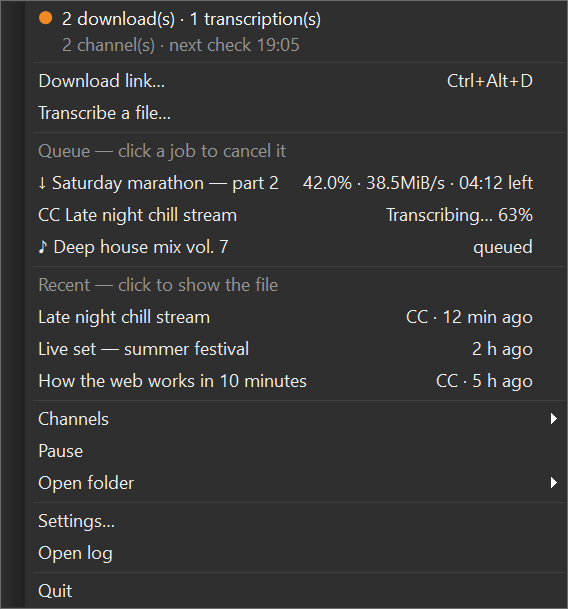
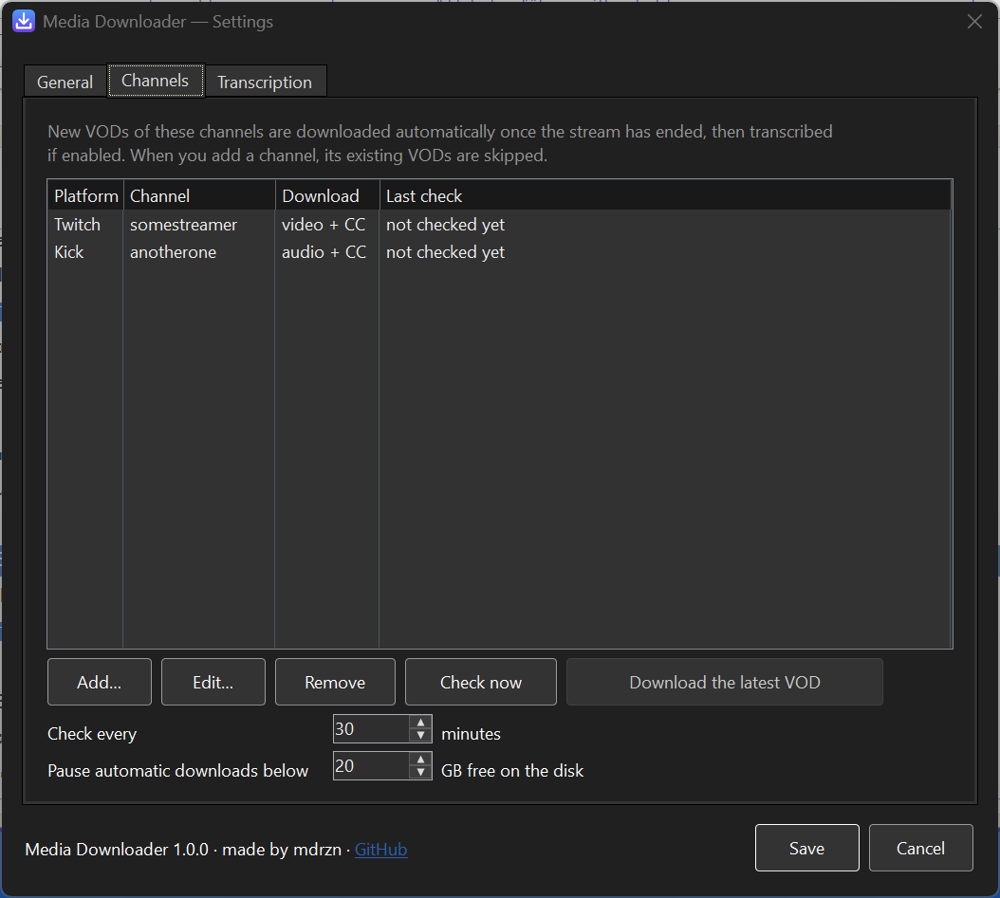
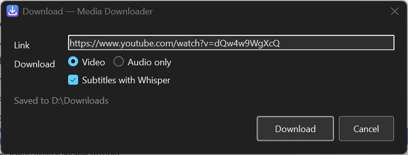

# ⬇️ Media Downloader

A small Windows tray app that downloads video and audio from YouTube, Twitch, Kick, SoundCloud and [hundreds of other sites](https://github.com/yt-dlp/yt-dlp/blob/master/supportedsites.md), follows streamers to grab their new VODs automatically, and adds subtitles with Whisper — all on your own PC.


<table>
<tr>
<td valign="top"></td>
<td valign="top"></td>
</tr>
</table>

## ✨ Features

- 📋 **Copy a link, get the file** — copy a YouTube, Twitch, Kick, SoundCloud (and more) link or a direct link to a media file, and a notification offers to download it. Or press <kbd>Ctrl</kbd>+<kbd>Alt</kbd>+<kbd>D</kbd>: video or audio only, with or without subtitles.
- 📺 **Follow streamers** — add Twitch and Kick channels and their new VODs are downloaded automatically once the stream has ended (never a half-finished recording), video or audio only, per channel.
- 💬 **Subtitles with Whisper** — `large-v3-turbo` (or `large-v3`) runs locally with [whisper.cpp](https://github.com/ggml-org/whisper.cpp), on the GPU if you have an NVIDIA card: on an RTX 4070 Ti SUPER a 1.5-hour Twitch VOD (1080p60, 4 GB) was downloaded in under a minute and subtitled in about 2 minutes. You get an `.srt` next to the file and a subtitle track inside the video, in the spoken language, detected automatically.
- 🎞️ **Ready for Jellyfin / Plex** — Twitch and Kick go to `<folder>\<streamer>\<date> - <title>.mp4`, subtitles as `<name>.en.srt`; everything else goes to a second folder. Video is always mp4 (plays everywhere, nothing re-encoded). Both folders and the file names are configurable.
- ⚡ **Fast even on slow disks** — files are downloaded and processed in a working folder on a fast SSD, then moved to their final folder (an external or network drive, say) in a single copy.
- 🧾 **Queue in the menu** — progress, speed and time left for every job; click one to cancel it. Recent files: click to show them in Explorer. The queue survives a restart.
- 🛠️ **Zero setup** — yt-dlp and ffmpeg are downloaded the first time (about 200 MB) and yt-dlp updates itself daily, since sites change often. Whisper is only downloaded when you first ask for subtitles.
- 📦 **One file** — a single `.exe` with .NET included; no Python, no console windows. English and Italian.


## 🚀 Install

1. Download `MediaDownloader.exe` from the [latest release](https://github.com/mdrzn/media-downloader/releases/latest).
2. Put it somewhere permanent, e.g. `%LOCALAPPDATA%\Programs\MediaDownloader\`, and run it. SmartScreen may warn about an unknown publisher (the app isn't code-signed): **More info → Run anyway**.
3. Open **Settings…** from the tray icon and choose your folders.

**Build it yourself** — needs the [.NET 10 SDK](https://dotnet.microsoft.com/download):

```powershell
git clone https://github.com/mdrzn/media-downloader.git
cd media-downloader
powershell -ExecutionPolicy Bypass -File app\build.ps1   # -> dist\MediaDownloader.exe
```

## 📸 Usage



| To… | Do |
|:--|:--|
| Download a link | Copy it and click the notification, or <kbd>Ctrl</kbd>+<kbd>Alt</kbd>+<kbd>D</kbd>, or *Download link…* |
| Follow a streamer | *Settings → Channels → Add…*, paste `twitch.tv/name` or `kick.com/name` |
| Grab a channel's latest VOD now | *Channels → <channel> → Download the latest VOD* |
| Subtitle a file you already have | *Transcribe a file…* |
| Cancel a job | Click it in the menu queue |
| Stop everything new from starting | *Pause* (running jobs finish) |
| Script it | `MediaDownloader.exe --download <url>`, `--audio <url>`, `--transcribe <file>`, `--latest <channel>`, `--check`, `--pause`, `--resume`, `--settings`, `--quit` |

When you add a channel, the VODs it already has are skipped: only new ones are downloaded from then on. Use *Download the latest VOD* to get the most recent one anyway.

## 🔧 Configuration

Everything is in **Settings**; the file behind it is `%APPDATA%\MediaDownloader\config.json`:

| Setting | Default |
|:--|:--|
| Twitch / Kick folder | `Videos\Streaming` (one subfolder per streamer) |
| Everything else | `Downloads` |
| File names | `%(upload_date>%Y-%m-%d)s - %(title).150B [%(id)s].%(ext)s` for streams, `%(title).150B [%(id)s].%(ext)s` otherwise ([yt-dlp templates](https://github.com/yt-dlp/yt-dlp#output-template)) |
| Video quality | Best available (or up to 2160p / 1440p / 1080p / 720p / 480p) |
| Audio format | mp3 (or m4a, opus, original) |
| Channels | checked every 30 minutes; automatic downloads wait if less than 20 GB are free |
| Subtitles | on for video, off for audio; `large-v3-turbo`, language detected automatically, also embedded as a track |
| Cookies file | optional `cookies.txt` for subscriber-only VODs and age-restricted videos |

The tools live in `%LOCALAPPDATA%\MediaDownloader\tools` (yt-dlp, ffmpeg, whisper.cpp and the Whisper models); *Settings → Transcription* shows their versions and can update or reinstall them. The log is in `%APPDATA%\MediaDownloader\downloader.log`.

## 🐛 Troubleshooting

- **A download fails** — the reason is in the notification and in *Open log*. Most of the time the site changed: *Settings → Transcription → Update yt-dlp now*. Subscriber-only or age-restricted content needs a cookies file.
- **Subtitles fail with "Memory allocation failure" or a CUDA error** — Windows ran out of *committed* memory (RAM + page file), even if Task Manager shows free RAM. Look for a process with huge memory usage, and let Windows manage the page file size.
- **No new VODs** — a VOD is only downloaded after the stream has ended. *Channels → Check now* forces a check; the result is shown next to each channel.
- **No GPU / not NVIDIA** — Whisper runs on the CPU instead: it works, just much slower; `large-v3-turbo` is the better choice there.

## 🙏 Built on

[yt-dlp](https://github.com/yt-dlp/yt-dlp) (downloads), [FFmpeg](https://ffmpeg.org) ([yt-dlp builds](https://github.com/yt-dlp/FFmpeg-Builds)), [whisper.cpp](https://github.com/ggml-org/whisper.cpp) and OpenAI's [Whisper](https://github.com/openai/whisper) models. They are downloaded from their official releases, not bundled.

Download only what you have the right to: respect each site's terms and the creators' rights.

## 📄 License

MIT — made by [mdrzn](https://github.com/mdrzn). See also [Windows Screenshot Uploader](https://github.com/mdrzn/windows-screenshot-uploader).
